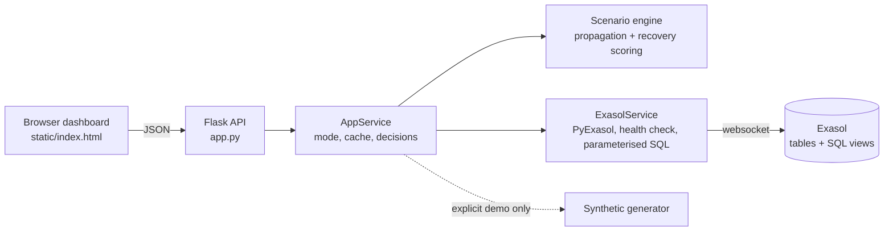

# SupplyShield — Continuity Engine

**Team Vyntrix · Exasol ExaThon India 2026 · Track: Factories, Fleets & Supply Chains**
*Anticipate disruption. Prevent cascading failures. Recover intelligently.*

| I want to… | Read |
|---|---|
| Run and demo it in 5 minutes | [RUN_GUIDE.md](RUN_GUIDE.md) |
| Set it up against an Exasol database, step by step | [DEPLOYMENT.md](DEPLOYMENT.md) |
| Understand what it is and how it works | this file |

---

## 1. Problem

A factory operations manager cannot quickly tell how a **supplier or shipment disruption** will affect **production, inventory and operating cost**, because the data lives in separate systems (supplier records, shipment tracking, stock, production plans).

**Target user:** operations and supply-chain planners at multi-plant manufacturers.

## 2. Solution

SupplyShield joins supplier, shipment, inventory and production-line data in **Exasol**, traces a disruption **supplier → shipment → inventory → production line**, quantifies the exposure, and compares recovery options against a **no-action baseline** using a transparent, documented score. It **recommends; it never executes** anything.

## 3. What is real and what is synthetic (please read)

| Mode | Where the numbers come from | How you enter it |
|---|---|---|
| **Exasol mode** | Queries against *your* Exasol database. The UI says "connected" only after a real `SELECT 1` succeeds and the dataset queries return. | Fill in `.env`, run the init and seed scripts, start the app. |
| **Synthetic demo mode** | Invented data generated in memory by `supplyshield/synthetic.py`. Labelled `SYNTHETIC DEMO DATA` on every screen. Nothing is read from Exasol. | **Only by an explicit click** ("Explore with SYNTHETIC demo data"). It is never substituted silently if Exasol fails. |

* **All data shipped with this project is synthetic** (invented suppliers, plants, shipments and events). No real or proprietary company data is used.
* The seed script loads the *same* synthetic dataset into Exasol and labels it `SYNTHETIC` in the `DATASET_META` table. So "Exasol mode" proves the Exasol integration works, **not** that the figures describe a real company.
* No machine-learning model is used, so there are no accuracy claims. Every number comes from a formula listed in [Transparent analytics](#10-transparent-analytics).

## 4. Features that are implemented

* **Command Center** — risk index with a visible formula, at-risk positions, suppliers, shipments and production lines, stockout timeline, open disruptions, recommended actions, assumptions.
* **Simulator** with 3 scenarios: *supplier failure*, *shipment disruption* (delay or port/route closure), *inventory shortage* (stock loss and/or demand surge).
* **Recovery comparison** — no action, alternative supplier, reroute, reallocate stock between plants, expedite — with a budget limit, a score, an approval flag, evidence and collapsible calculations.
* **Decision log** — approve / reject / defer with a note and timestamp, stored in Exasol (or in memory in demo mode).
* **Data Source page** — connection test, per-table row counts read from Exasol, active dataset label, setup steps.
* **98 automated unit tests** (see [Testing](#12-run-the-tests)).

## 5. Technology stack and architecture

Python 3.10+, **Flask** (web server and JSON API), **PyExasol** (database driver), **python-dotenv** (reads `.env`), plain HTML/CSS/JavaScript front end (no build step), Exasol SQL tables and views.



The browser never talks to Exasol and never sees credentials.

### Project layout

```
app.py                  Flask app (python app.py)
supplyshield/           config.py, db.py, service.py, scenarios.py, analytics.py, synthetic.py
sql/01_schema.sql       tables         (run via scripts\init_db.py)
sql/02_views.sql        analytics views (run via scripts\init_db.py)
scripts/init_db.py      create schema, tables, views in Exasol
scripts/seed_db.py      load the SYNTHETIC dataset into Exasol
static/                 index.html, app.js, styles.css
tests/                  unit tests (+ optional live-Exasol integration tests)
setup_windows.bat       one-time setup (venv + dependencies + .env)
run_app.bat             start the app
run_tests.bat           run the unit tests
.env.example            template for your connection settings
```

## 6. Prerequisites

* **Windows 10 or 11** with **Command Prompt (CMD)**.
* **Python 3.10 or newer** from <https://www.python.org/downloads/>. In the installer tick **"Add python.exe to PATH"**. Check with `python --version`.
* An **Exasol database** *only if* you want Exasol mode — Exasol SaaS or Exasol Personal. Demo mode needs no database and no internet connection after installation.
* An internet connection for the one-time `pip install`.

## 7. Windows setup (CMD)

Open **Command Prompt**, go to the project folder (the one containing `app.py`), then use **either** the one-step script **or** the manual commands.

**One step:**
```bat
cd /d C:\path\to\supplyshield
setup_windows.bat
```
It creates `.venv`, installs `requirements.txt`, and copies `.env.example` to `.env` if `.env` does not exist yet.

**Manual equivalent:**
```bat
cd /d C:\path\to\supplyshield
python -m venv .venv
.venv\Scripts\activate
pip install -r requirements.txt
copy .env.example .env
```
After `activate`, your prompt starts with `(.venv)`. You must activate the environment in every new CMD window before running `python` commands below (`run_app.bat` and `run_tests.bat` do it for you).

> `requirements.txt` contains exactly three packages: `flask`, `pyexasol`, `python-dotenv`.

## 8. Start the app

### 8a. Demo mode (no Exasol needed)
```bat
run_app.bat
```
(or, with the environment activated: `python app.py`). You should see:
```
SupplyShield running at http://127.0.0.1:5000  (Ctrl+C to stop)
```
Open **<http://127.0.0.1:5000>**. (`run_app.bat` tries to open the browser for you; if the page shows "can't connect", wait two seconds and refresh.)

With no Exasol settings, the first screen is **"Choose a data source"**. Click **Explore with SYNTHETIC demo data**. The top-right pill turns amber (`SYNTHETIC DEMO DATA`) and a banner states that nothing was read from Exasol.

Stop the app with **Ctrl+C** in the CMD window.

### 8b. Exasol mode
Follow section 9 first, then start the app the same way. If `.env` is filled in and the connection and dataset load succeed, the app opens directly in Exasol mode (green pill `Exasol · connected`).

## 9. Exasol setup and connection

### 9.1 What you need from Exasol

| `.env` variable | What to put there | Exasol SaaS | Exasol Personal |
|---|---|---|---|
| `EXASOL_DSN` | `host:port` | The **connection string** from the SaaS web console, then `:8563` (default port) | Host/IP and port from your instance's connection details |
| `EXASOL_USER` | database user | The **user name** shown in the SaaS console's connect details | Your database user |
| `EXASOL_PASSWORD` | password | Your **personal access token (PAT)** — shown only once when created | Your database password |

For Exasol SaaS, Exasol's own documentation also requires that **the database is running** and that **your computer's public IP address is in the database's allowed-IP list** (SaaS console → Security). Create the token in the console and copy it immediately. This project has **not been verified against a live SaaS database** — see [Known limitations](#13-known-limitations).

The Exasol user needs permission to create a schema, tables and views, and to insert, update and delete rows. Nothing in this README grants those permissions for you.

### 9.2 Configure `.env`
```bat
notepad .env
```
Replace the three `<placeholder>` values. Leave the rest as is unless you know you need it:

| Variable | Required | Default | Meaning |
|---|---|---|---|
| `EXASOL_DSN` | yes | — | `host:port` |
| `EXASOL_USER` | yes | — | database user |
| `EXASOL_PASSWORD` | yes | — | password or SaaS access token |
| `EXASOL_SCHEMA` | no | `SUPPLYSHIELD` | schema the app creates and uses |
| `EXASOL_VALIDATE_CERT` | no | `true` | `false` only for a self-signed certificate on a development database |
| `EXASOL_ENCRYPTION` | no | `true` | TLS on/off (leave on; Exasol SaaS requires it). Supported by the code, not listed in `.env.example` |

An untouched `.env.example` (values in `<angle brackets>`) is treated as **not configured**, so a fresh clone shows "Exasol · not configured", not a connection error.

**Important:** the app reads `.env` once at start-up. **Stop and restart the app after every `.env` change.** A Windows environment variable with the same name takes precedence over the file.

If you get a TLS/certificate error, the preferred fix is the certificate fingerprint in the DSN (`host/FINGERPRINT:8563`, PyExasol syntax). `EXASOL_VALIDATE_CERT=false` is for development only.

### 9.3 Create the schema, tables and views (once)
```bat
python scripts\init_db.py
```
It tests the connection, then runs `sql\01_schema.sql` (13 statements) and `sql\02_views.sql` (8 statements). Expected end of output:
```
Connected to Exasol. Target schema: SUPPLYSHIELD
Executed 01_schema.sql
Executed 02_views.sql
Done: 21 statements. Next: python scripts/seed_db.py
```
If the schema already contains tables it stops and tells you; `python scripts\init_db.py --reset` **drops the whole schema and deletes all its data, including saved simulation history**.

### 9.4 Load the synthetic seed data
```bat
python scripts\seed_db.py
```
Expected output (row counts are fixed for the default seed):
```
  dataset_meta           5 rows
  components             6 rows
  suppliers              8 rows
  supplier_components   10 rows
  factories              3 rows
  production_lines       8 rows
  routes                14 rows
  inventory              8 rows
  shipments             15 rows
  delivery_history     120 rows
  disruptions            3 rows
Seeded SYNTHETIC data (seed=42, as_of=<today>). Scenario history tables were left untouched.
```
It is re-runnable: it deletes and reloads only the 11 seed tables. Options: `--seed 42` and `--as-of YYYY-MM-DD`.

### 9.5 Test the database connection

**In the browser:** start the app → **Data Source** → **Test connection (SELECT 1)**. Success shows a green state and the latency; expand **Row counts** under *Active dataset* for the per-table `COUNT(*)` values read from Exasol.

**From CMD** (environment activated):
```bat
python -c "from supplyshield.config import get_settings; from supplyshield.db import ExasolService; print(ExasolService(get_settings()).health_check())"
```
Success prints `{'ok': True, 'latency_ms': ...}`. Failure prints an error message that never contains your password.

Then press **Use Exasol data** on the Data Source page if the app is not already in Exasol mode.

### 9.6 How to confirm it is genuinely connected
* The top-right pill is green **"Exasol · connected"**, and the banner shows the dataset label (`SYNTHETIC` for the seed data).
* Run a simulation: the result line says **"saved to Exasol (SCENARIO_RUNS, RECOVERY_OPTIONS)"**. Then, in any SQL client connected to the same database:
  ```sql
  SELECT RUN_ID, CREATED_AT, SCENARIO_TYPE, DECISION FROM SUPPLYSHIELD.SCENARIO_RUNS ORDER BY CREATED_AT DESC;
  ```
* Stop or pause the database and press **Refresh data**: you get a connection error, **not** demo data.

## 10. Transparent analytics

* **Cover days** = usable stock ÷ daily consumption (usable = on-hand floored at 0; none if consumption ≤ 0).
* **Stockout** — day-by-day projection of usable stock + *recorded* inbound shipments − consumption over a 45-day window. Shipments arriving after depletion do not help. Beyond the window, un-ordered replenishment is not treated as a risk.
* **Supplier risk (0–100)** = weighted on-time shortfall 35, average delay 15, lead time 20, capacity utilisation 15, criticality 15. Missing factors are skipped and weights re-normalised; below 50 % coverage → "UNKNOWN", no score.
* **Propagation** — supplier failure holds undispatched shipments (in-transit ones continue) until restart; port closure delays every shipment on routes via that port; inventory shock removes stock and/or multiplies demand. Production loss = stockout-equivalent days × daily line output × margin per unit.
* **Recovery options** — alternative supplier (quantity capped at 50 % of capacity × 30 days; cost = quantity × price premium over standard cost + setup fee), reroute (alternative open route, same region, not via the closed port), reallocate (donor must stay above max(safety, 7 days) and not be short itself), expedite. Only premiums and fees count as action cost.
* **Score** = 100 × (1 − Σ weight × normalised penalty): total cost 30 %, recovery time 20 %, production loss 20 %, unmet-demand share 15 %, operational risk 15 % (min-max over eligible options). Operational-risk bases are assumptions: no action 10, alternative supplier 40 (blended with supplier risk), reroute 25, reallocate 20 (+15 per donor stockout day), expedite 25.
* **Risk index** = 100 × (0.5 × criticality-weighted share of positions short within the window + 0.3 × average supplier risk + 0.2 × late/cancelled inbound share).
* All constants live in `supplyshield/config.py` and are shown in the UI.

### How Exasol is actually used

| | |
|---|---|
| Tables read | `COMPONENTS, SUPPLIERS, SUPPLIER_COMPONENTS, FACTORIES, PRODUCTION_LINES, ROUTES, INVENTORY, SHIPMENTS, DELIVERY_HISTORY, DISRUPTIONS, DATASET_META` |
| Tables written | `SCENARIO_RUNS` (run + human decision), `RECOVERY_OPTIONS` (every evaluated option) |
| SQL views | `V_INVENTORY_POSITION`, `V_SUPPLIER_PERFORMANCE`, `V_SUPPLIER_COMMITMENT`, `V_INBOUND_SUPPLY`, `V_DISRUPTION_IMPACT`, `V_ALT_SUPPLIER_CANDIDATES`, `V_DASHBOARD_KPIS`, `V_RECOVERY_COMPARISON` |

The dashboard loads inventory, supplier performance, commitments and KPI counts **from these views**; the time-phased stock projection, propagation and option scoring run in Python over the returned rows.

**Data model:** `SUPPLIER_COMPONENTS(supplier, component)` · `PRODUCTION_LINES → FACTORIES, COMPONENTS` · `ROUTES → FACTORIES` · `INVENTORY(factory, component)` · `SHIPMENTS → SUPPLIERS, FACTORIES, COMPONENTS, ROUTES` · `DELIVERY_HISTORY → SUPPLIERS, COMPONENTS` · `DISRUPTIONS(entity_type, entity_id)` · `RECOVERY_OPTIONS → SCENARIO_RUNS`. Exasol records but does not enforce PK/FK constraints by default, so `synthetic.check_integrity` verifies them before seeding (and in tests).

## 11. Governance

Simulations are automatic. Any real change is a **recommendation**: approval is flagged when action cost exceeds ₹25,000 or a new supplier is involved. Approve / Reject / Defer + note + timestamp are stored (Exasol, or memory in demo mode, lost on restart). Nothing is ordered.

## 12. Run the tests

```bat
run_tests.bat
```
or, with the environment activated:
```bat
python -m unittest discover -s tests -v
```
**What was actually run for this documentation update** (Python 3.12, Linux sandbox, with fake database objects): **98 tests, OK, 3 skipped**. The 3 skipped tests are the live-Exasol integration tests. They were **not** run against any Exasol database.

To run the integration tests against your own database (read-only; they never modify data):
```bat
set RUN_EXASOL_INTEGRATION=1
python -m unittest tests.test_integration_exasol -v
```
`set` only lasts for the current CMD window. If your `.env` is filled in, the three tests run instead of being skipped. The unit tests cover cover-days/stockout maths, supplier risk and missing data, propagation, option comparison, invalid inputs, connection failure, no silent demo fallback, SQL-file-to-column mapping, loader mapping, placeholder `.env` handling, and the API contract.

## 13. Known limitations

* **Not verified against a live Exasol database** (neither in the original build session nor in this documentation update): the SQL in `sql\*.sql`, the PyExasol calls, `init_db.py`, `seed_db.py`, and live-mode reads/writes were exercised only through test doubles. Run section 9 and the integration tests to verify on your database.
* **Exasol SaaS authentication:** the app passes `EXASOL_USER` and `EXASOL_PASSWORD` to PyExasol. For SaaS, Exasol documents using a personal access token in the password position. PyExasol's own README additionally shows a `refresh_token` option for SaaS; **this app has no setting for it**. If a PAT-as-password login is rejected on your database, that would need a code change.
* The `.bat` scripts and CMD commands here follow the project files; they were **not executed on a Windows machine** during this update.
* Durations (outage, closure) are planning assumptions, not forecasts. A production line depends on one component. Inter-factory transfer time and cost is a flat assumption. Options are evaluated one position at a time; combined plans and shared stock across positions are not modelled. Door-to-door lead time is used for alternative suppliers.
* Single-user local app: **no login, no HTTPS, in-memory state**, and a new database connection per query. It is **not production-ready**; see [DEPLOYMENT.md](DEPLOYMENT.md#7-production-considerations).
* No machine learning.

## 14. Troubleshooting

| Symptom | Likely cause and fix |
|---|---|
| `'python' is not recognized` | Python is not installed or not on PATH. Reinstall and tick **Add python.exe to PATH**, then open a **new** CMD window. |
| `'pyexasol' package is not installed` / `ModuleNotFoundError` | Environment not activated or dependencies missing: `.venv\Scripts\activate`, then `pip install -r requirements.txt`. |
| `Run setup_windows.bat first.` | `.venv` does not exist yet. Run `setup_windows.bat`. |
| Browser says "can't connect" right after `run_app.bat` | The browser opened before the server was ready. Wait and refresh. |
| `Address already in use` / port 5000 busy | `set SUPPLYSHIELD_PORT=5001` then `python app.py`, and open `http://127.0.0.1:5001` yourself (`run_app.bat` always opens 5000). |
| Pill says **Exasol · not configured** | `.env` missing, empty, or still holds the `<placeholders>`. Fill it in and **restart** the app — or click the demo button. |
| `Authentication failed` | Check `EXASOL_USER` / `EXASOL_PASSWORD`. For SaaS the password must be a valid, un-revoked access token. |
| `Could not reach Exasol` / timeout | Wrong host or port; SaaS database is stopped; or your IP is not in the SaaS allowed-IP list; or a firewall blocks port 8563. |
| `TLS certificate could not be verified` | Put the certificate fingerprint in the DSN (`host/FINGERPRINT:8563`), or (development only) `EXASOL_VALIDATE_CERT=false`. |
| `Connected, but schema SUPPLYSHIELD could not be opened` | Run `python scripts\init_db.py` and then `python scripts\seed_db.py`. |
| `DATASET_META is empty` | Run `python scripts\seed_db.py`. |
| `.env` edits seem ignored | Restart the app; check for a Windows environment variable of the same name (`set EXASOL`). |
| `init_db.py` says the schema "already has N tables" | Intended safety stop. Use `--reset` only if deleting the schema's data is acceptable. |
| Fonts look plain offline | The UI falls back to system fonts. Harmless. |

## 15. Security guidance

* **Never commit `.env`, tokens, passwords or certificates.** `.gitignore` already excludes `.env`, `.env.*` (except `.env.example`), `*.pem`, `*.key`, `secrets/` and `credentials*`. Before every commit run `git status` and confirm `.env` is not listed; `git check-ignore -v .env` should print a matching rule.
* `.env.example` must contain **placeholders only**. Do not paste real values into it, into screenshots, issues, chat messages, or a shared ZIP.
* If a credential is ever committed or shared, **treat it as compromised**: revoke or replace the token/password in Exasol first, then clean the repository history.
* Use a database user with only the privileges the app needs, ideally a dedicated schema.
* In the code: the password is never returned by any endpoint or logged; error messages replace it with `***`; values go through PyExasol's query formatter and identifiers through `{x!i}`; dynamic table/column names are allow-listed in `config.TABLE_COLUMNS`; the browser has no database access.
* The app has **no authentication**. It listens on `127.0.0.1` (this computer only) by default. Do not set `SUPPLYSHIELD_HOST=0.0.0.0` on a network you do not trust.

## License
MIT — see `LICENSE`.
