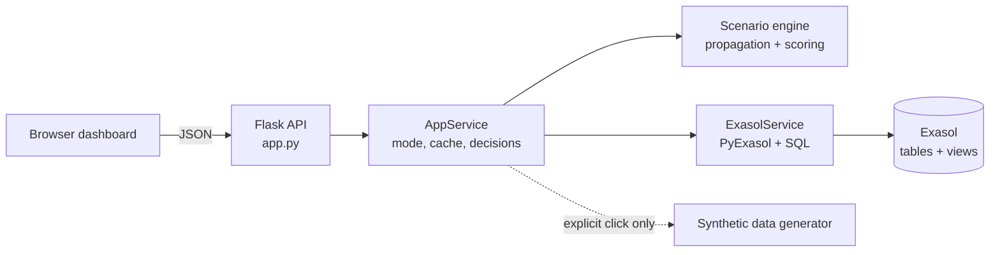

# SupplyShield — Continuity Engine

A small web dashboard that shows how a supplier or shipment disruption could hit factory production, and compares recovery options before stock runs out.

**Team Vyntrix** · Exasol ExaThon India 2026 · Track: Factories, Fleets & Supply Chains

> **The data in this project is synthetic.** Every supplier, plant, shipment and event is invented. Nothing here describes a real company, and every cost or stockout figure is an estimate from stated assumptions, not a measurement or a forecast.

## The problem

When a supplier fails or a shipment is held up, an operations planner has to work out which parts, shipments, plants and production lines are affected, and what to do about it. That information usually sits in separate systems (supplier records, shipment tracking, stock levels, production plans), so the answer takes too long to assemble.

## How SupplyShield works

1. **Pick a disruption:** a supplier failure, a shipment delay or port/route closure, or an inventory shortage.
2. **Trace the impact:** supplier → shipment → inventory → production line, with a day-by-day stock projection over a 45-day window.
3. **Compare recovery options** against a "no action" baseline: alternative supplier, reroute, move stock between plants, or expedite. Each option gets a cost, a recovery time and a score.
4. **Record a human decision** (approve, reject or defer, with a note).

SupplyShield only recommends. It never places an order or changes an external system. There is no machine learning in it: every number comes from a formula or assumption you can see in the app.



The browser never talks to Exasol and never sees credentials.

## What is implemented

- **Command Center:** risk index (with the formula one click away), at-risk stock positions, suppliers, shipments and production lines, stockout timeline, open disruptions, recommended actions and the assumptions used.
- **Simulator:** three scenarios (supplier failure, shipment disruption, inventory shortage) with a cascade view and a stock-projection chart.
- **Recovery comparison:** no action, alternative supplier, reroute, reallocate stock between plants and expedite, with a budget limit, score, approval flag and the calculations behind each option.
- **Decision log:** approve / reject / defer with a note and timestamp. Stored in Exasol in Exasol mode, or in memory in demo mode (lost on restart).
- **Data Source page:** connection test, per-table row counts, and which dataset is active.

Approval is flagged when an option's action cost is above ₹25,000 or involves a new supplier. All constants (weights, fees, thresholds) are in `supplyshield/config.py` and shown in the UI.

## Tech stack

Python 3.10+, Flask, PyExasol, python-dotenv, plain HTML/CSS/JavaScript (no build step) and Exasol SQL tables and views. The three Python dependencies are listed in `requirements.txt`.

## Quick start (Windows, synthetic demo mode)

You need Windows 10/11 and Python 3.10 or newer from [python.org](https://www.python.org/downloads/) (tick **Add python.exe to PATH** in the installer). Demo mode needs no database.

In Command Prompt, from the folder that contains `app.py`:

```bat
setup_windows.bat
run_app.bat
```

`setup_windows.bat` is a one-time step: it creates `.venv`, installs the dependencies and copies `.env.example` to `.env`. You can leave `.env` alone for demo mode.

`run_app.bat` starts the server and opens http://127.0.0.1:5000. If the browser says it can't connect, wait a couple of seconds and refresh. Then click **Explore with SYNTHETIC demo data**. The pill in the top right turns amber and a banner confirms that nothing was read from Exasol. Stop the app with `Ctrl+C`.

Port 5000 busy? Run `set SUPPLYSHIELD_PORT=5001` and then `python app.py` (with `.venv` activated), and open http://127.0.0.1:5001 yourself. `run_app.bat` always opens port 5000. More help is in [RUN_GUIDE.md](RUN_GUIDE.md).

To run the tests:

```bat
run_tests.bat
```

## Exasol integration: status and testing

**Short version: the Exasol integration is written but has not been verified against a live database.**

What exists in the repo:

- `supplyshield/db.py` (PyExasol connection, `SELECT 1` health check, parameterised queries)
- `sql/01_schema.sql` and `sql/02_views.sql` (tables and analytics views)
- `scripts/init_db.py` and `scripts/seed_db.py` (create the schema, load the synthetic dataset)
- Code that writes simulation runs and decisions to `SCENARIO_RUNS` and `RECOVERY_OPTIONS`

What has *not* been verified: the SQL files, the PyExasol calls, the two scripts, and live reads and writes have only been exercised through test doubles (fake database objects). They have never been run against a real Exasol database, SaaS or Personal. For Exasol SaaS, the app passes the user and password to PyExasol, and Exasol documents using a personal access token as the password. PyExasol's `refresh_token` option has no setting in this app, so if token-as-password login is rejected, that would need a code change.

Even once connected, the seeded rows are still the same invented data (labelled `SYNTHETIC` in the `DATASET_META` table). A working Exasol connection would show that the integration works, not that the figures describe a real company.

**Test results:** 98 automated tests, all passing apart from 3 skipped. The 3 skipped tests are the live-Exasol integration tests; they were not run against any database, so no live-Exasol test result exists yet. The `.bat` scripts were not executed on a Windows machine when this was last documented.

```bat
python -m unittest discover -s tests -v
```

To try the integration tests on your own database (they are read-only), fill in `.env`, then run:

```bat
set RUN_EXASOL_INTEGRATION=1
python -m unittest tests.test_integration_exasol -v
```

Step-by-step Exasol setup (`.env` values, `init_db.py`, `seed_db.py`, how to confirm the connection is real) is in [DEPLOYMENT.md](DEPLOYMENT.md). The app only shows "Exasol · connected" after a real `SELECT 1` succeeds, and it never silently falls back to demo data if Exasol is unreachable.

## Limitations

- Outage and closure durations are planning assumptions, not forecasts.
- Options are evaluated one stock position at a time; combined plans and shared stock across positions are not modelled.
- A production line depends on a single component, and inter-plant transfer time and cost are flat assumptions.
- Single-user local app: no login, no HTTPS, in-memory state. Not production-ready.

## Security

- Never commit `.env`, passwords or tokens. Keep real values out of `.env.example`, screenshots and shared ZIP files. If a credential is ever shared, revoke it in Exasol first.
- The app has no authentication and listens on `127.0.0.1` by default. Don't set `SUPPLYSHIELD_HOST=0.0.0.0` on a network you don't trust.
- The database password is never returned by an API endpoint or written to logs.

## More documentation

- [RUN_GUIDE.md](RUN_GUIDE.md): run and demo the app
- [DEPLOYMENT.md](DEPLOYMENT.md): set up against an Exasol database
- [LICENSE](LICENSE): MIT
