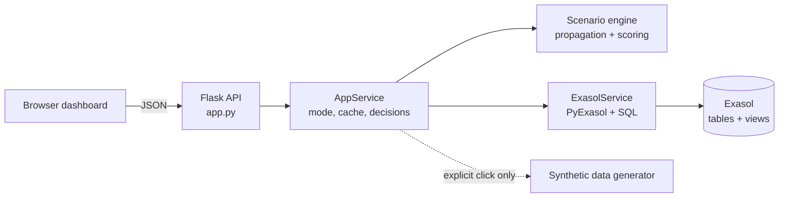

# SupplyShield — Continuity Engine

A small web dashboard that shows how a supplier or shipment disruption could hit factory production, and compares recovery options before stock runs out.

**Team Vyntrix** · Exasol ExaThon India 2026 · Track: Factories, Fleets & Supply Chains

## The problem

Operations planners can't quickly see how a supplier or shipment disruption will hit production, inventory and cost, because the data lives in separate systems: supplier records, shipment tracking, stock levels and production plans. Working out which parts, plants and production lines are affected, and what to do about it, takes too long.

> **The data in this project is synthetic.** Every supplier, plant, shipment and event is invented. Nothing here describes a real company, and every cost or stockout figure is an estimate from stated assumptions, not a measurement or a forecast. This stays true even when the app is connected to Exasol: the seed script loads the same invented dataset.

## How SupplyShield works

1. **Pick a disruption:** a supplier failure, a shipment delay or port/route closure, or an inventory shortage.
2. **Trace the impact:** supplier → shipment → inventory → production line, with a day-by-day stock projection over a 45-day window.
3. **Compare recovery options** against a "no action" baseline: alternative supplier, reroute, move stock between plants, or expedite. Each option gets a cost, a recovery time and a score.
4. **Record a human decision** (approve, reject or defer, with a note).

SupplyShield only recommends. It never places an order or changes an external system. There is no machine learning in it: every number comes from a formula or assumption you can see in the app.



The browser never talks to Exasol and never sees credentials.

## What is implemented

- **Command Center:** risk index (with the formula one click away), at-risk stock positions, suppliers, shipments and production lines, stockout timeline, open disruptions, recommended actions and the assumptions used.
- **Simulator:** three scenarios (supplier failure, shipment disruption, inventory shortage) with a cascade view and a stock-projection chart.
- **Recovery comparison:** no action, alternative supplier, reroute, reallocate stock between plants and expedite, with a budget limit, score, approval flag and the calculations behind each option.
- **Decision log:** approve / reject / defer with a note and timestamp. Stored in Exasol in Exasol mode, or in memory in demo mode (lost on restart).
- **Data Source page:** connection test, per-table row counts, and which dataset is active.

Approval is flagged when an option's action cost is above ₹25,000 or involves a new supplier. All constants (weights, fees, thresholds) are in `supplyshield/config.py` and shown in the UI.

## Tech stack

Python 3.10+, Flask, PyExasol, python-dotenv, plain HTML/CSS/JavaScript (no build step) and Exasol SQL tables and views. The three Python dependencies are listed in `requirements.txt`.

## Quick start (Windows, synthetic demo mode)

You need Windows 10/11 and Python 3.10 or newer from [python.org](https://www.python.org/downloads/) (tick **Add python.exe to PATH** in the installer). Demo mode needs no database.

In Command Prompt, from the folder that contains `app.py`:

```bat
setup_windows.bat
run_app.bat
```

`setup_windows.bat` is a one-time step: it creates `.venv`, installs the dependencies and copies `.env.example` to `.env`. You can leave `.env` alone for demo mode.

`run_app.bat` starts the server and opens http://127.0.0.1:5000. If the browser says it can't connect, wait a couple of seconds and refresh. Then click **Explore with SYNTHETIC demo data**. The pill in the top right turns amber and a banner confirms that nothing was read from Exasol. Stop the app with `Ctrl+C`.

Port 5000 busy? Run `set SUPPLYSHIELD_PORT=5001` and then `python app.py` (with `.venv` activated), and open http://127.0.0.1:5001 yourself. `run_app.bat` always opens port 5000. More help is in [RUN_GUIDE.md](RUN_GUIDE.md).

## Using the app

The left menu has four pages.

1. **Command Center:** start here. Check the risk index, how many stock positions are at stockout risk, the earliest projected stockout, and the estimated cost if no action is taken. The "How is this calculated?" and "?" buttons show the formulas. Under *Open disruptions*, click **Open in simulator →** on the supplier failure.
2. **Simulator & Recovery:** pick a scenario (or keep the one you opened), adjust the parameters such as outage length and budget limit, and click **Run simulation**. You get the cascade (supplier → shipments → stock → line), a projected-stock chart (no disruption vs. no action vs. recommended) and the recovery comparison table, starting with the no-action baseline. Under the recommendation you can add an optional note and choose approve, reject or defer. Nothing is ordered; the decision is only recorded.
3. **Decision Log:** every run with its decision, note and where it is stored (memory in demo mode, Exasol in Exasol mode).
4. **Data Source:** shows the active mode and dataset label, runs the connection test (`SELECT 1`) and lists row counts.

To run the unit tests:

```bat
run_tests.bat
```

## Exasol integration: status and testing

**Short version: the Exasol integration is written but has not been verified against a live database.**

What exists in the repo:

- `supplyshield/db.py` (PyExasol connection, `SELECT 1` health check, parameterised queries)
- `sql/01_schema.sql` and `sql/02_views.sql` (tables and analytics views)
- `scripts/init_db.py` and `scripts/seed_db.py` (create the schema, load the synthetic dataset)
- Code that writes simulation runs and decisions to `SCENARIO_RUNS` and `RECOVERY_OPTIONS`

What has *not* been verified: the SQL files, the PyExasol calls, the two scripts, and live reads and writes have only been exercised through test doubles (fake database objects). They have never been run against a real Exasol database, SaaS or Personal. For Exasol SaaS, the app passes the user and password to PyExasol, and Exasol documents using a personal access token as the password. PyExasol's `refresh_token` option has no setting in this app, so if token-as-password login is rejected, that would need a code change.

Even once connected, the seeded rows are still the same invented data (labelled `SYNTHETIC` in the `DATASET_META` table). A working Exasol connection would show that the integration works, not that the figures describe a real company.

**Unit test results:** 98 automated tests, all passing apart from 3 skipped. The 3 skipped tests are the live-Exasol integration tests; they were not run against any database. The `.bat` scripts were not executed on a Windows machine when this was last documented.

```bat
python -m unittest discover -s tests -v
```

### Testing with a live Exasol database

Full setup is in [DEPLOYMENT.md](DEPLOYMENT.md). The short version, in order:

1. Open `.env` and fill in `EXASOL_DSN` (`host:port`), `EXASOL_USER` and `EXASOL_PASSWORD` from your own database. Never paste these into the README, screenshots or chat. Restart the app after every `.env` change. For Exasol SaaS, the database must be running and your public IP must be on its allowed-IP list.
2. Create the schema and views, then load the synthetic data (`--reset` deletes the whole schema, so don't use it on data you want to keep):
   ```bat
   python scripts\init_db.py
   python scripts\seed_db.py
   ```
3. Start the app and open **Data Source**. Click **Test connection (SELECT 1)**, then **Use Exasol data**. The top-right pill should read "Exasol · connected" and the banner should show the `SYNTHETIC` dataset label. If something fails, the app shows a connection error. It does not switch to demo data.
4. Run a simulation. The result should say "saved to Exasol (SCENARIO_RUNS, RECOVERY_OPTIONS)". If saving fails, it shows an error instead. Check in an SQL client:
   ```sql
   SELECT RUN_ID, CREATED_AT, SCENARIO_TYPE, DECISION FROM SUPPLYSHIELD.SCENARIO_RUNS ORDER BY CREATED_AT DESC;
   ```
5. Record a decision and check that the `DECISION` column updates.
6. Run the read-only integration tests:
   ```bat
   set RUN_EXASOL_INTEGRATION=1
   python -m unittest tests.test_integration_exasol -v
   ```
7. Optional: stop the database and press **Refresh data**. You should get a connection error.

**Live verification record.** Fill this in only with what you actually saw, and don't change the status above until every row passes.

| Check | Result |
|---|---|
| `SELECT 1` connection test | Not yet verified |
| Schema, tables and views created (`init_db.py`) | Not yet verified |
| Synthetic data loaded (`seed_db.py`) | Not yet verified |
| Dashboard loads from Exasol (green pill, row counts) | Not yet verified |
| Simulation run written to `SCENARIO_RUNS` / `RECOVERY_OPTIONS` | Not yet verified |
| Decision written and visible in `SCENARIO_RUNS` | Not yet verified |
| 3 integration tests pass | Not yet verified |

## Limitations

- Outage and closure durations are planning assumptions, not forecasts.
- Options are evaluated one stock position at a time; combined plans and shared stock across positions are not modelled.
- A production line depends on a single component, and inter-plant transfer time and cost are flat assumptions.
- Single-user local app: no login, no HTTPS, in-memory state. Not production-ready.

## Security

- Never commit `.env`, passwords or tokens. Keep real values out of `.env.example`, screenshots and shared ZIP files. If a credential is ever shared, revoke it in Exasol first.
- The app has no authentication and listens on `127.0.0.1` by default. Don't set `SUPPLYSHIELD_HOST=0.0.0.0` on a network you don't trust.
- The database password is never returned by an API endpoint or written to logs.

## More documentation

- [RUN_GUIDE.md](RUN_GUIDE.md): run and demo the app
- [DEPLOYMENT.md](DEPLOYMENT.md): set up against an Exasol database
- [LICENSE](LICENSE): MIT
